<div align="center">


<h3>A Living Research Atlas</h3>

<p>Le portfolio scientifique de <b>Dr. Marine A. Courtois</b> — biologie mathématique, dynamique des populations,<br>technique de l'insecte stérile. Docteure de l'Université Côte d'Azur depuis le 27 novembre 2025.</p>

<p>


</p>

<p>
<a href="#-en-mouvement">En mouvement</a> ·
<a href="#-la-science-qui-tourne-vraiment">La science</a> ·
<a href="#-le-site">Le site</a> ·
<a href="#-démarrer">Démarrer</a> ·
<a href="#-architecture">Architecture</a> ·
<a href="docs/">Documentation</a>
</p>

</div>

<br>

> **Ce portfolio ne dit pas que Marine sait modéliser : il fait tourner ses modèles.**
> Ses deux systèmes d'équations publiés sont transcrits depuis ses notebooks publics, recalculés en direct dans le
> navigateur et vérifiés contre ses propres figures. Chaque courbe mène à la publication, au DOI et au code d'origine.

<br>

## ◐ En mouvement

<div align="center">
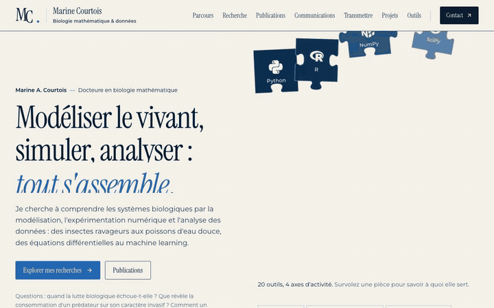
<br>
<sub>Visite enregistrée dans le navigateur (31 s) — <a href="docs/assets/tour.mp4">version MP4 haute définition</a></sub>
</div>

<br>

## ◑ Le parcours

Chaque module du **Model Explorer** suit le même mouvement. Une compétence n'est jamais affirmée : elle est démontrée par une réalisation scientifique réelle.

<table>
<tr>
<td width="33%" valign="top">

### Observer
**le mécanisme**

Les hypothèses et les équations du modèle, telles qu'écrites dans le code publié, rendues avec KaTeX côté serveur.

</td>
<td width="33%" valign="top">

### Explorer
**les paramètres**

Intensité des lâchers, fertilité résiduelle, règle d'utilisation du sperme… les trajectoires sont recalculées à chaque mouvement de curseur.

</td>
<td width="33%" valign="top">

### Comprendre
**les résultats**

Une lecture chiffrée de la courbe, puis un accès direct à la **publication**, au **DOI**, au **code** et à la **méthodologie**.

</td>
</tr>
</table>

<br>

## ◒ La science qui tourne vraiment

| Modèle | Transcrit depuis | Vérification |
| :-- | :-- | :-- |
| **Fertilité résiduelle** · EDO à 3 variables (S, F, M) | [`Script_Manuscrit_SIT_RF.ipynb`](https://gitlab.com/marinecourtois/thesisData) | σ = 500 → F(300) ≈ 18 · 175 (δ = 1 %) · 47 (ε = 1 %), conformément à la figure du notebook |
| **Ré-accouplement** · EDO à 5 variables (L, M, F<sub>I</sub>, F<sub>F</sub>, S) | [`Compartmental_model_output_vAvril.ipynb`](https://gitlab.com/marinecourtois/thesisData) | Panneaux A et B : à σ = 450 000, « First » élimine la population, « Last » se stabilise vers 22 700 |
| **Modèle discret** F<sub>t+1</sub> = λF²/(F+S) | [`fig_chapter2_thesis.ipynb`](https://gitlab.com/marinecourtois/thesisData) | Équilibres 0 et S/(λ−1), diagramme en toile d'araignée |
| **Lâchers impulsionnels** | [`Notebook_part_impulsive_releases.ipynb`](https://gitlab.com/marinecourtois/thesisData) | Solution périodique analytique |
| **Individu-centré** (démonstrateur ×1/50) | [`script_ABM_batchrun.py`](https://gitlab.com/marinecourtois/sit_remating_abm) (Mesa) | Règles conservées, simplifications signalées sur la page |

Les tests de non-régression (`tests/unit/models.test.ts`) vérifient ces valeurs à chaque commit.
Détails : [`docs/SCIENTIFIC_VISUALIZATIONS.md`](docs/SCIENTIFIC_VISUALIZATIONS.md).

<br>

## ◓ Le site

<table>
<tr>
<td colspan="2">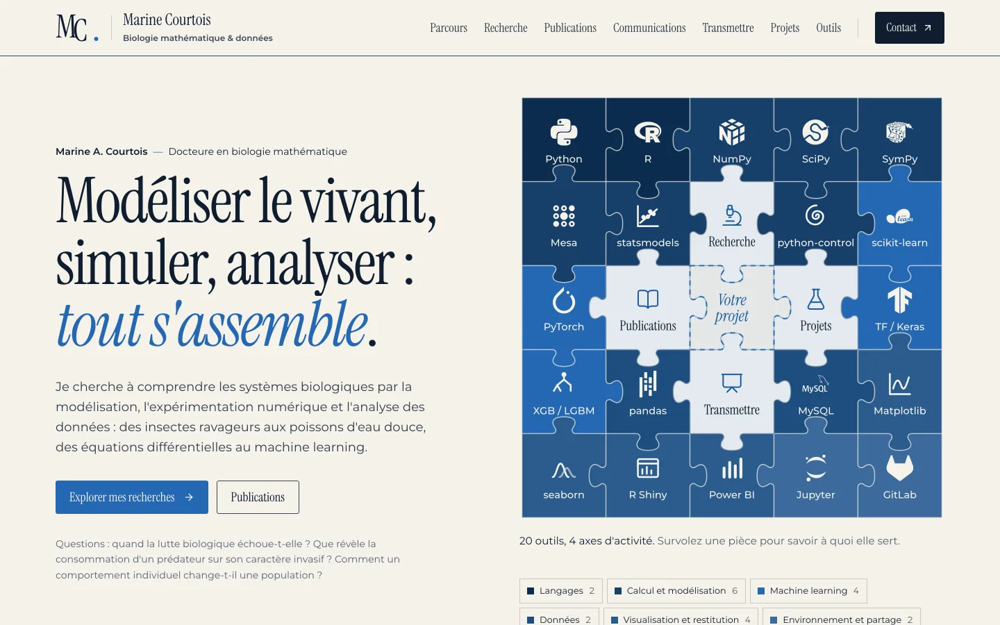</td>
</tr>
<tr>
<td colspan="2">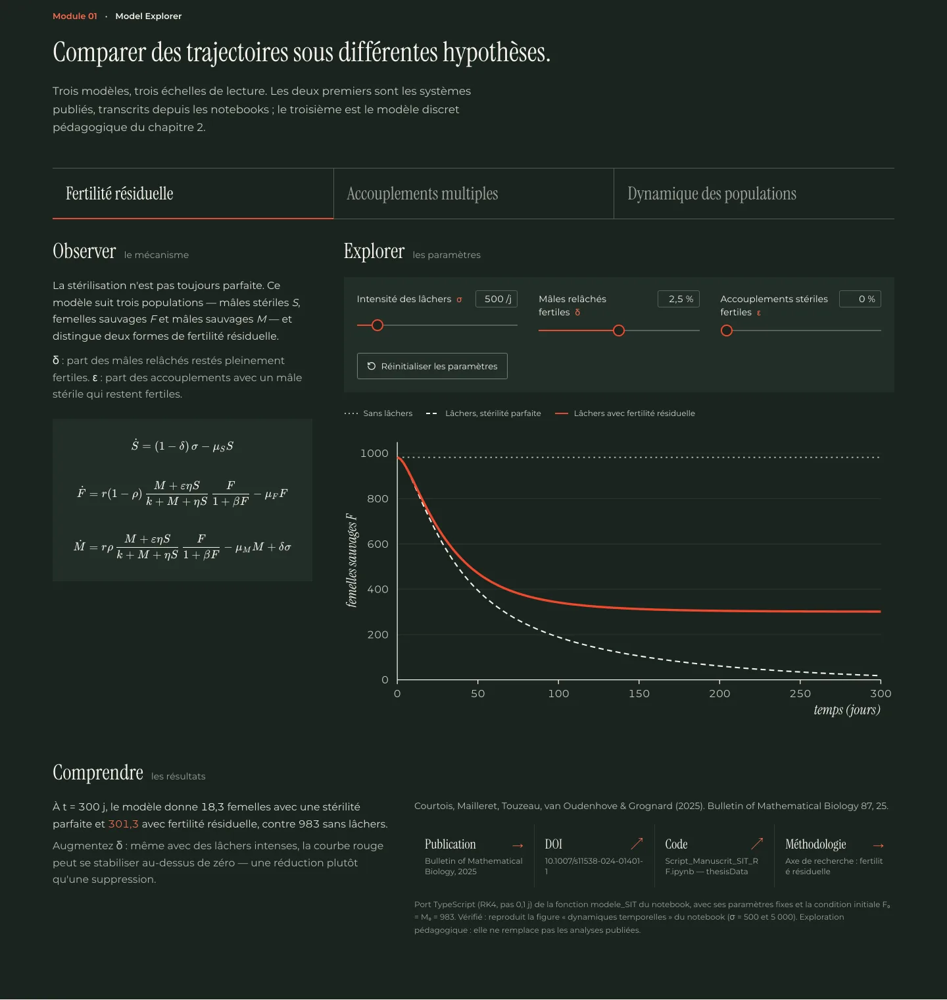</td>
</tr>
<tr>
<td width="50%">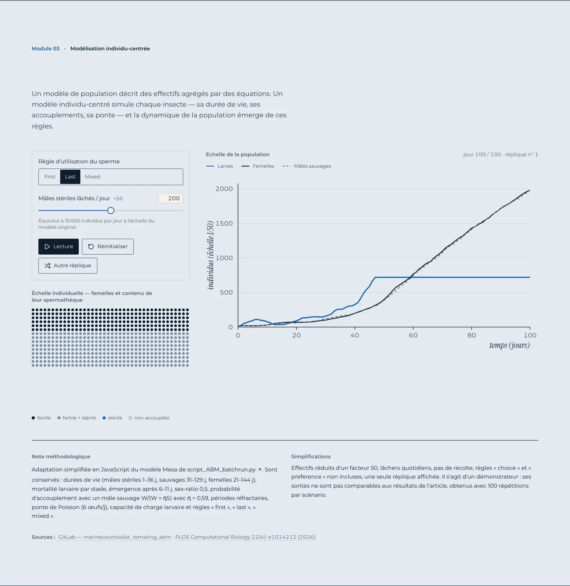</td>
<td width="50%">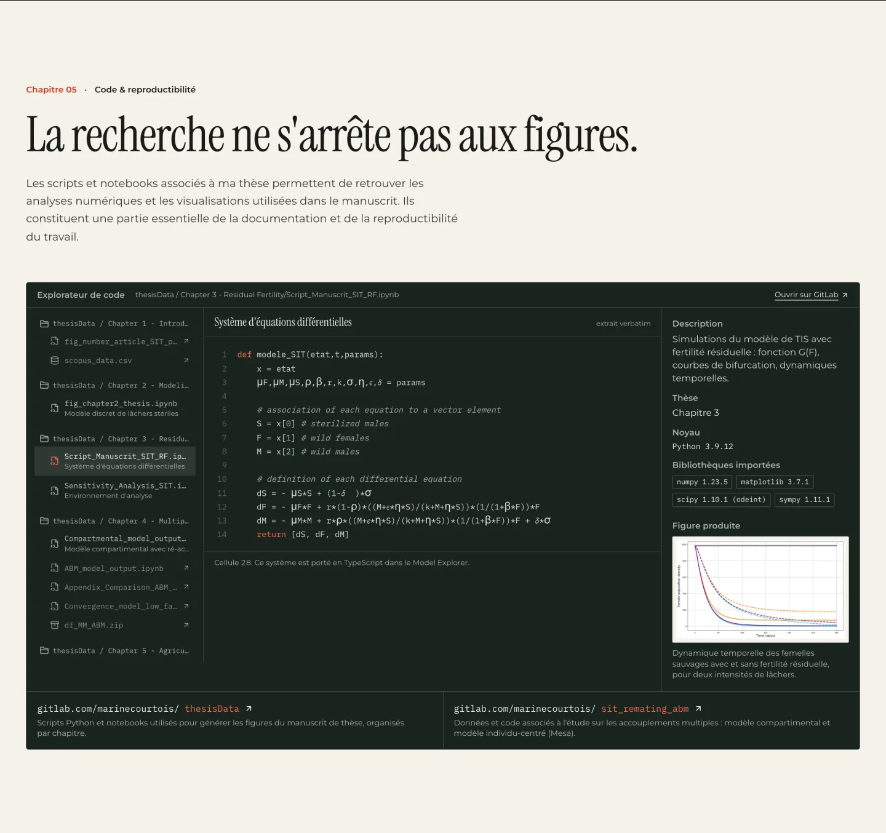</td>
</tr>
<tr>
<td width="50%">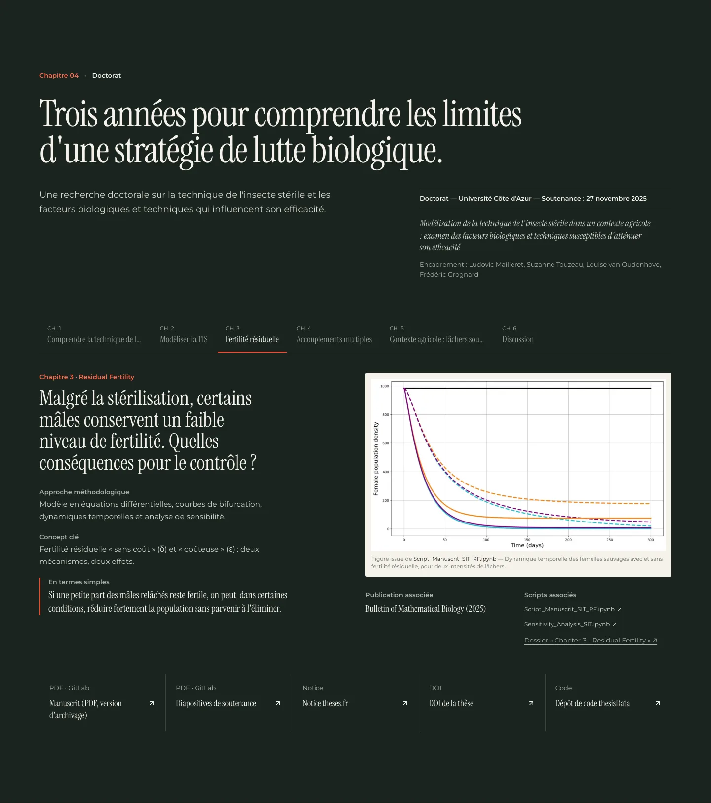</td>
<td width="50%">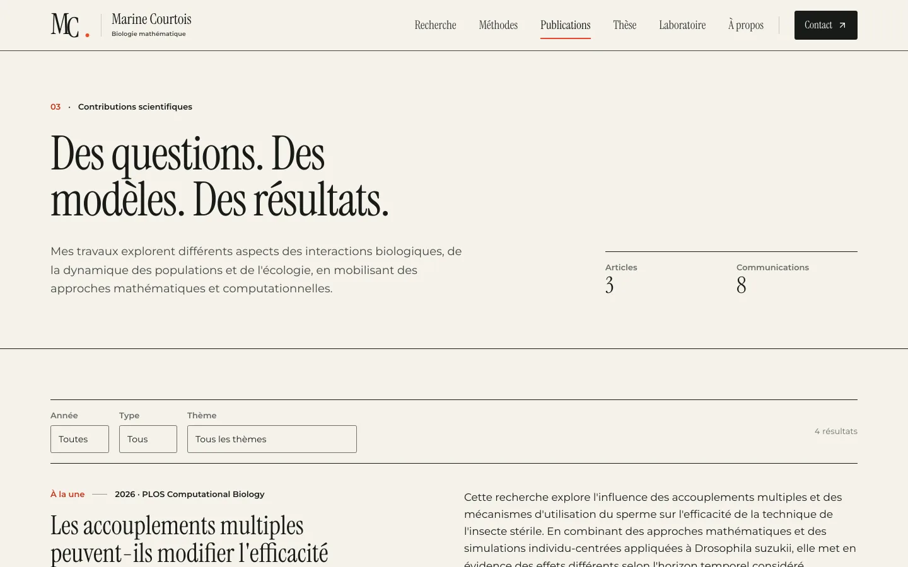</td>
</tr>
</table>

<p align="center">
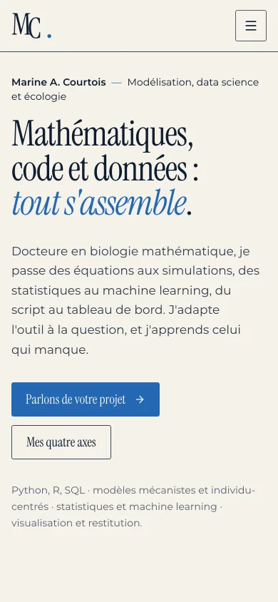&nbsp;&nbsp;&nbsp;
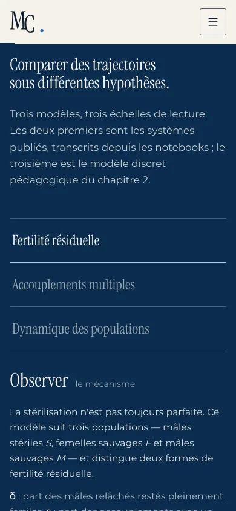
</p>

| Route | Contenu |
| :-- | :-- |
| `/` | Living System, introduction, méthodes et Model Explorer, publications, thèse, code, contact |
| `/recherche` · `/recherche/[slug]` | 6 axes : TIS, fertilité résiduelle, accouplements multiples, individu-centré, stratégies de lâchers, écologie des invasions |
| `/methodes` | Boîte à outils : chaque compétence reliée à une publication et aux imports réels du code |
| `/publications` · `/publications/[slug]` | 3 articles, la thèse, 8 communications (HAL), filtres, données structurées |
| `/these` | Explorateur des 6 chapitres, manuscrit PDF, diapositives de soutenance |
| `/laboratoire` | Model Explorer, séquence TIS, lâchers impulsionnels, modèle individu-centré, explorateur de code |
| `/a-propos` · `/contact` | Parcours vérifié, intérêts de recherche, courriel et profils |

<br>

## ◔ Intégrité scientifique

```
  Faits vérifiés        Crossref · ORCID · HAL · theses.fr · DataCite · GitLab
  Explications          reformulées sans dépasser les sources
  Illustratif           nuage de points du hero, schéma TIS, démonstrateur ABM — signalés à l'écran
  Absent, à dessein     poste actuel, prix, financements, citations, équations décoratives, jauges de compétences
```

La provenance de chaque affirmation est tracée dans [`docs/CONTENT_SOURCES.md`](docs/CONTENT_SOURCES.md).

<br>

## ◕ Démarrer

```bash
corepack enable
pnpm install
pnpm dev                 # http://localhost:3000
```

| Commande | Rôle |
| :-- | :-- |
| `pnpm build` · `pnpm start` | build et serveur de production |
| `pnpm lint` · `pnpm typecheck` | ESLint · TypeScript strict |
| `pnpm test` | 24 tests Vitest (modèles, données, composants) |
| `pnpm test:e2e` | 36 tests Playwright, desktop 1440 px et mobile 390 px (après `pnpm build`) |
| `pnpm readme:banner` | régénère la bannière animée à partir du modèle |
| `pnpm readme:screens` · `pnpm readme:tour` | captures et visite vidéo (serveur de production sur `:3300`) |

En production, définissez `NEXT_PUBLIC_SITE_URL` (URL canoniques, sitemap, Open Graph).

<br>

## ● Architecture

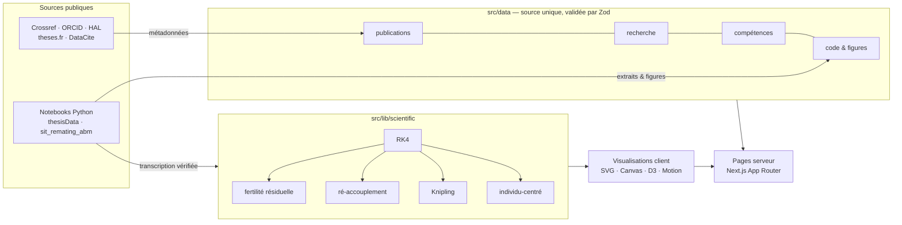

```
src/
├── app/                  10 routes · sitemap · robots · image Open Graph générée à partir du modèle
├── components/
│   ├── editorial/        hero, chapitres, en-têtes
│   ├── visualizations/   Living System · Model Explorer (explorer/) · ABM · graphiques
│   ├── interactions/     publications · compétences · thèse · code · contrôles
│   └── scientific/       KaTeX serveur · sources · sections
├── data/                 contenus typés et sourcés
├── i18n/                 libellés d'interface (prêts pour l'anglais)
└── lib/scientific/       modèles portés depuis les notebooks
```

<br>

## ◖ Modifier le contenu

- **Publication** : ajouter un objet dans `src/data/publications.ts`. L'index, les filtres, la fiche, le sitemap et le JSON-LD suivent automatiquement.
- **Communication** : `RAW_COMMUNICATIONS`, dans le même fichier (avec l'identifiant HAL).
- **Axe de recherche** : `src/data/research.ts`. La page `/recherche/<slug>` est générée automatiquement.
- **Source** : `src/data/sources.ts`, puis `docs/CONTENT_SOURCES.md`.

`pnpm test` refuse toute référence croisée cassée (publication, code, figure ou source introuvable).

<br>

## ◗ Design

Papier chaud `#F5F2EB`, encre `#171B18`, un seul accent vermillon `#F04A2D` réservé aux variables du modèle et aux actions,
chapitres sombres `#19241F`. **Instrument Serif** pour les titres, **Montserrat** pour le texte et l'interface, monospace
réservé au code. Passe anti-slop avec [taste-skill](https://github.com/Leonxlnx/taste-skill) : pas de micro-libellés en
capitales, de dégradés, de verre, de cartes à icône ni de jauges. Le mouvement respecte `prefers-reduced-motion` et se met
en pause hors écran. Détails : [`docs/DESIGN_SYSTEM.md`](docs/DESIGN_SYSTEM.md).

<br>

## Documentation

| | |
| :-- | :-- |
| [`DESIGN_SYSTEM.md`](docs/DESIGN_SYSTEM.md) | tokens, typographie, règles, mouvement |
| [`CONTENT_SOURCES.md`](docs/CONTENT_SOURCES.md) | provenance de chaque affirmation |
| [`SCIENTIFIC_VISUALIZATIONS.md`](docs/SCIENTIFIC_VISUALIZATIONS.md) | équations, paramètres, vérifications |
| [`IMPLEMENTATION.md`](docs/IMPLEMENTATION.md) | phases et rapport QA |

<br>

<div align="center">
<sub>Recherche, modèles, code et figures scientifiques © Marine A. Courtois — <a href="https://orcid.org/0009-0002-3623-1460">ORCID</a> · <a href="https://gitlab.com/marinecourtois">GitLab</a>.<br>
Polices Instrument Serif et Montserrat sous licence SIL Open Font License, intégrées à la bannière.</sub>
</div>
